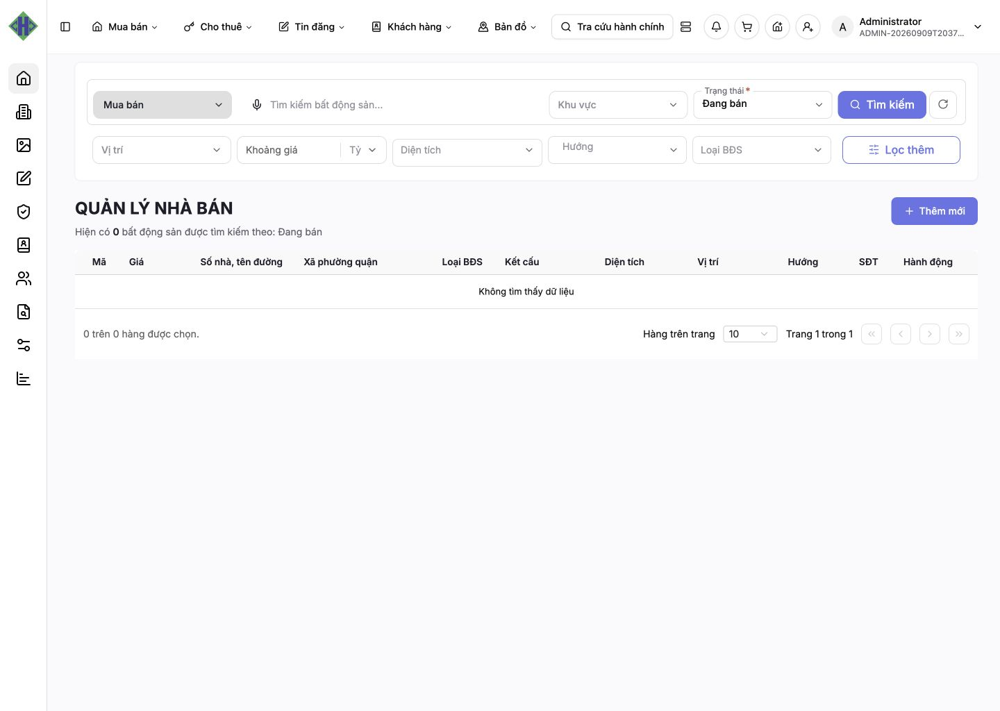
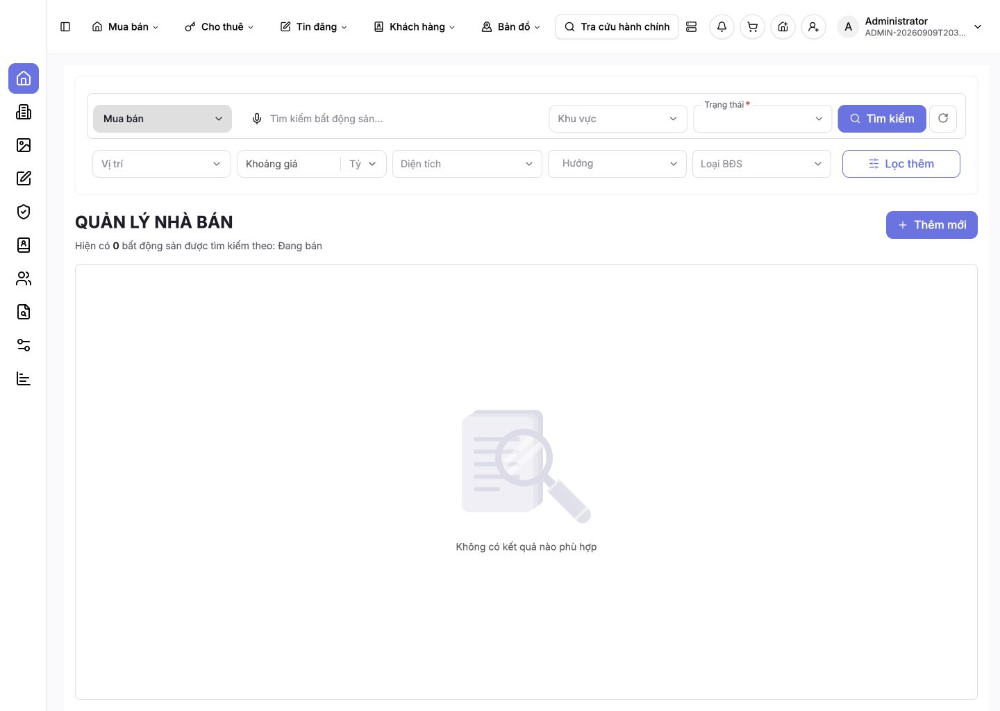
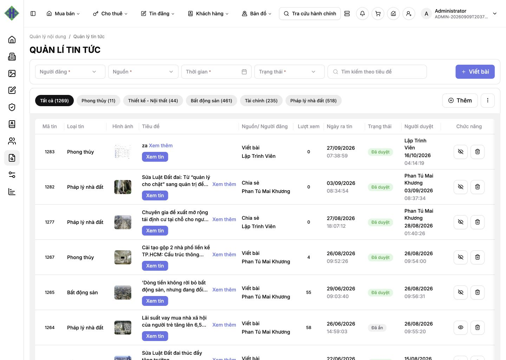
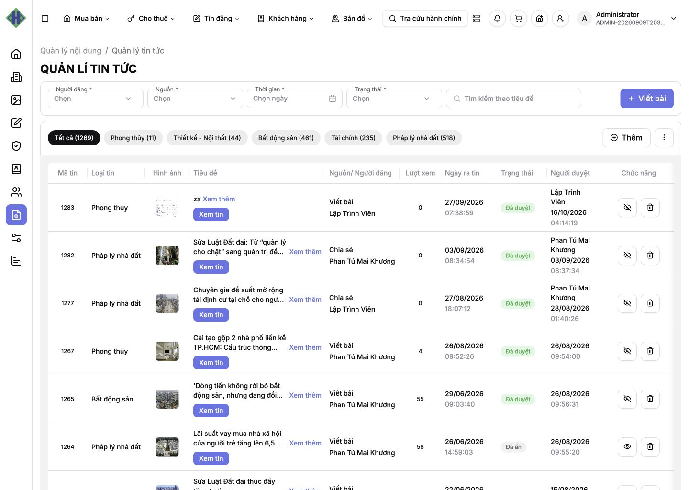
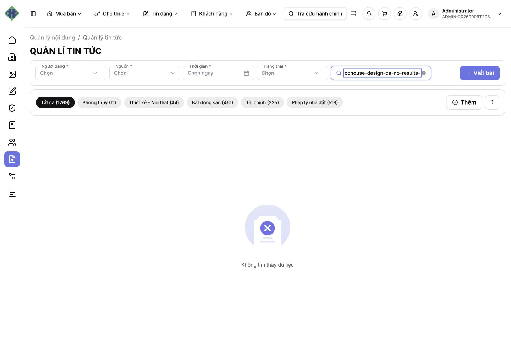
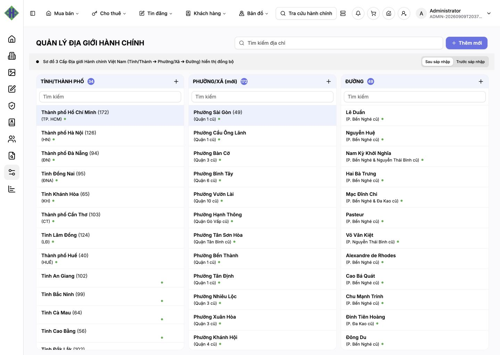
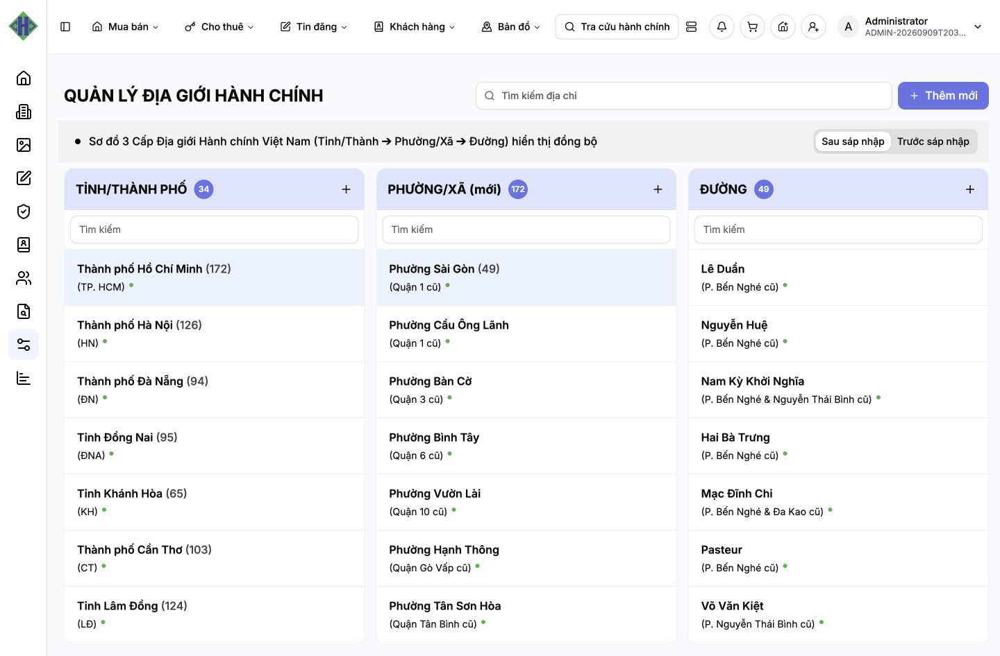
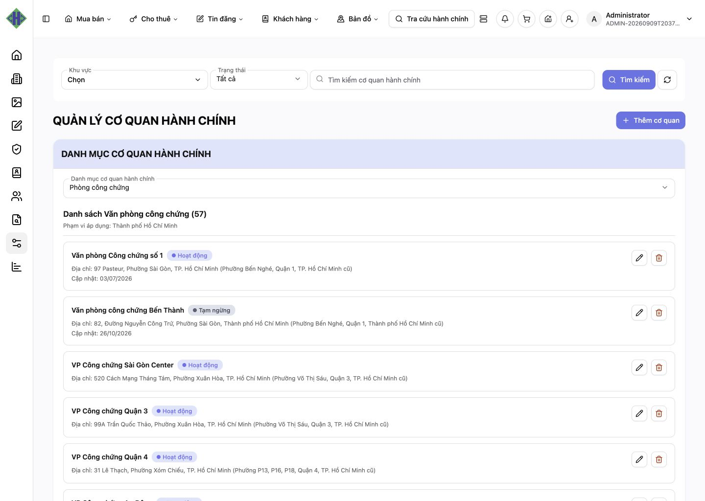
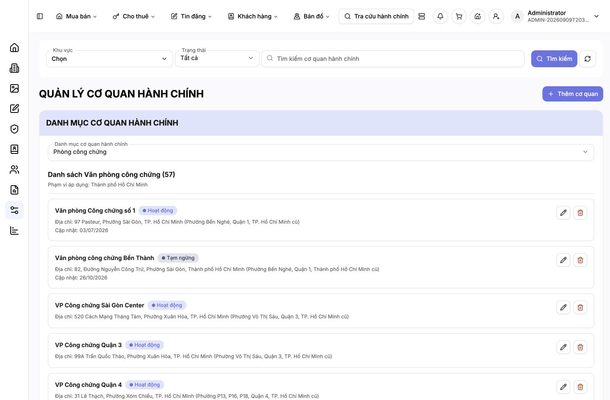

Cập nhật mới nhất: [sửa chọn khu vực và thu gọn trang Mua bán](area-selector-fix.md).

# C.C.House Admin — Figma audit và kiểm chứng

> **Cập nhật16/11/2026:** báo cáo này là lịch sử vòng đầu. Các điểm chủ quan bên dưới không xác nhận pixel-perfect. Xem [audit mới](figma-audit.md), [đối chiếu và số đo](visual-differences.md), [triển khai responsive](implementation-report.md) và [kiểm thử](regression-report.md) cho kết quả hiện tại.

Ngày: 15/11/2026 (Asia/Ho_Chi_Minh). Phạm vi duy nhất: `/Users/dlb/cchouse/test/cchouse_admin_website_v2`.

Đã chỉnh giao diện của cả bốn route, tái sử dụng Next.js App Router, Ant Design, sidebar, API clients và các form hiện có. Không thay dữ liệu bằng mock, không sửa backend/public website, không thay xác thực hay quyền. Các thay đổi chưa commit có sẵn được giữ lại.

## Node → route và điểm thiết kế

Điểm là đánh giá trực quan chủ quan trên thang 10, dựa trên layout, typography, hình học component và trạng thái hiển thị; không phải phép đo pixel tự động. Không chấm nội dung/tổng số từ API giống dữ liệu mẫu Figma. Điểm không chứng minh mọi trạng thái trong section đã khớp tuyệt đối.

- **132:14425 → `/admin/property?TransType=1`: 6 → 8.5/10.** Đối chiếu màn hình chính `214:48004` và no-results `2301:69424`. Sửa nền/padding trang, nút và active sidebar, table header 44px/row 124px ở desktop, vùng cuộn, empty state đúng SVG Figma. API hiện trả 0 kết quả ở bộ lọc mặc định; chưa kiểm chứng trực quan hàng BĐS có dữ liệu.
- **2420:136701 → `/admin/config/news`: 7 → 8.5/10.** Đối chiếu `5102:157268`, body `5102:157270`, và form `3114:162988`. Sửa breadcrumb 16px, nhãn filter luôn nổi trên viền, placeholder, empty state 128px/căn giữa, trạng thái chọn category, thao tác bàn phím của dropdown nguồn. Bảng dùng dữ liệu thật: 1.269 bài trong phiên kiểm tra.
- **4837:185121 → `/admin/config/address-manager`: 6.5 → 9/10.** Đối chiếu `4837:196672`, modal `4918:287152`. Sửa heading 24px, header cột 60px, tên dòng 16px, chi tiết 14px, dòng khoảng 80px, input 40px, khoảng cách; mobile cuộn ngang từng cột và xếp riêng mô tả/chuyển chế độ.
- **4939:291895 → `/admin/config/agency-manager`: 7 → 9/10.** Đối chiếu `4968:329858`, modal `4984:334401`. Bỏ padding lặp, dùng typography/theme chung, giữ card và trạng thái động. Bộ lọc mobile xếp toàn chiều rộng. Phiên sau sửa tải 57 cơ quan; ảnh baseline được chụp khi danh sách ban đầu còn rỗng.

Hai frame địa giới/cơ quan chứa **78px browser chrome**. Ảnh Figma gốc là 1440×1024; ảnh app sau sửa của hai route là 1440×946 để bỏ phần browser chrome. Baseline được chụp ở 1440×1024 trước khi chuẩn hóa này; so sánh vị trí app cần bù phần chiều cao đó. Property/news kiểm tra ở 1440×1024. Mobile: 390×844. Không có frame mobile được chỉ định, nên mobile là kiểm tra thích nghi, không chấm pixel với Figma.

## Các sai lệch ban đầu và xử lý

- **Chung / mức vừa:** shell mới chưa có CSS dùng chung; font, primary và focus không đồng nhất. File: `src/components/layouts/index.tsx`, `src/lib/components/AntProvider.tsx`. Đã thêm token chung và CSS chỉ áp dụng bốn route.
- **132:14425 / mức cao:** no-results vẫn là table trống nhỏ, khác panel/illustration Figma. File: `src/lib/components/admin/property/table/index.tsx`. Đã dùng hai SVG đúng kích thước gốc 117×146.947 và 138×136; giữ nhánh loading/error/cart riêng.
- **2420:136701 / mức vừa:** illustration bị CSS thu còn 64px, nhãn filter nằm trong ô, breadcrumb 13px. File: `src/lib/components/admin/news/listing/index.tsx`, `src/lib/components/admin/news/filter/index.tsx`. Đã sửa geometry, placeholder và keyboard, dùng file SVG mới để giữ nguyên asset chưa commit của người dùng.
- **4837:185121 / mức vừa:** chữ/cột/dòng nhỏ hơn spec; mobile ép mô tả thành cột hẹp. File: `src/lib/pages/config/address/address-manager/index.tsx`. Đã sửa các kích thước và xác nhận lại bằng screenshot mobile sau khi phát hiện lỗi thực tế.
- **4939:291895 / mức vừa:** padding lặp đẩy nội dung lệch; mobile filter chia cột khó đọc. File: `src/lib/pages/config/agency-manager/index.tsx`. Đã sửa padding và bố cục mobile; xác nhận lại screenshot.

## Ảnh trước và sau

Ảnh baseline được tạo bằng cách tạm khôi phục HEAD cộng patch chưa commit ban đầu đã lưu, chụp trình duyệt thực, rồi khôi phục toàn bộ phần triển khai. Không dùng ảnh Figma làm ảnh sản phẩm.

### Bất động sản

Trước:

Sau:

### Tin tức

Trước:

Sau (dữ liệu thật):

Trạng thái không tìm thấy dữ liệu qua truy vấn thật:

### Địa giới

Trước:

Sau:

### Cơ quan hành chính

Trước (danh sách còn rỗng lúc chụp):

Sau (dữ liệu đã tải):

### Mobile và modal

- [BĐS mobile](property-mobile.jpg)
- [Tin tức mobile](news-mobile.jpg) · [Form mobile](news-form-mobile.jpg)
- [Địa giới mobile](address-mobile.jpg) · [Modal](address-form-after.jpg)
- [Cơ quan mobile](agency-mobile.jpg) · [Modal](agency-form-after.jpg)
- [Form tin tức desktop](news-form-after.jpg)

Bốn PNG tham chiếu Figma nằm trong `figma/`; đây chỉ là bằng chứng QA, không được dùng trong UI.

## Component/token dùng chung và file

Tạo mới:

- `src/lib/core/configs/admin-design.ts`: token Ant Design/CSS cho bốn route, gồm primary mobile.
- `src/lib/styles/admin-design.css`: typography, layout, empty state, focus và responsive có scope.
- `src/lib/components/shared/AdminEmptyState.tsx`: trạng thái rỗng có thông báo screen reader, dùng cho property/news.
- `public/assets/admin/news-empty-figma.svg`, `property-empty-documents.svg`, `property-empty-search.svg`: asset tải từ Figma; giữ nguyên `news-empty.svg` có sẵn của người dùng.
- `docs/design-qa/`: ảnh, log và báo cáo này.

Sửa:

- `src/components/layouts/index.tsx`
- `src/lib/components/AntProvider.tsx`
- `src/lib/components/admin/news/filter/index.tsx`
- `src/lib/components/admin/news/listing/index.tsx`
- `src/lib/components/admin/property/table/index.tsx`
- `src/lib/pages/config/address/address-manager/index.tsx`
- `src/lib/pages/config/agency-manager/index.tsx`

Không thêm dependency vào package.json/lockfile. Giữ các file `.github/` và asset chưa commit có sẵn.

## Regression và giới hạn

Đã kiểm tra thực trong trình duyệt:

- Đăng nhập bằng tài khoản được cung cấp; cả bốn route có xác thực mở được.
- GET qua proxy trả 200 cho dữ liệu property, news, province và các lookup; xác nhận news và agency có dữ liệu thật.
- BĐS: mở/đóng bộ lọc nâng cao và form thêm mới; no-results hiển thị đúng; hai SVG có geometry thực gần đúng kích thước native, không bị ép toàn khung.
- News: tìm kiếm trả empty state; nguồn mở bằng Enter, chọn giá trị đóng menu (`aria-expanded=false`) và URL có `SourceType=write`; mở/đóng editor; SVG empty đo đúng 128×128.
- Địa giới: chuyển trước/sau sáp nhập; modal thêm mới mở/đóng; nội dung cột tải được.
- Cơ quan: modal mở/đóng; chế độ địa chỉ cũ hiện Quận/Huyện và Phường/Xã cũ; nút lưu form trống bị disabled.
- Bốn trang mobile không gây overflow toàn document: width đo được 390px trên viewport 390px. Bảng news và cột địa giới có cuộn ngang bên trong theo thiết kế thích nghi.

Chưa thực hiện ghi/xóa/duyệt bài, upload, thay quyền hoặc thay mật khẩu để tránh thay dữ liệu thật. Chưa kiểm thử các role ngoài admin, toàn bộ bộ lọc kết hợp, và toàn bộ trạng thái con của các section lớn. Trạng thái có dữ liệu của bảng BĐS còn cần kiểm chứng khi API trả bản ghi cho bộ lọc đang dùng.

Console có cảnh báo Ant Design deprecated props/findDOMNode, circular references, TinyMCE evaluation/license và Next Image logo. Các cấu hình/callsite gốc này đã tồn tại; không coi console là sạch. Không quan sát crash trong các luồng đã kiểm tra. Chi tiết thông báo: `browser-console.json`.

Có URL asset Figma tạm thời tồn tại sẵn ở `src/lib/pages/home/index.tsx`, ngoài bốn route đang triển khai; không sửa ngoài phạm vi. Asset mới của lần này đều là file local.

## Kết quả kiểm tra tự động

- Production smoke: bốn route admin trả 307 khi chưa đăng nhập; ba SVG mới trả 200 (`production-smoke.json`).
- TypeScript: **PASS**, `npm run type-check` (`typecheck.log`).
- Test hiện có: **22/22 PASS**, news validation và client-error permissions/persistence (`tests.log`). Đây không phải bộ E2E đầy đủ của bốn trang.
- Lint toàn repo: **FAIL có sẵn — 17 errors, 43 warnings** (`lint.log`). Đã so với bản nguồn ban đầu: cùng 17/43; không thêm diagnostic mới. Sáu file mới/sửa được kiểm riêng: PASS (`changed-files-lint.log`); news listing vẫn có warning `handleInputConfirm` chưa dùng từ trước.
- Production build: **PASS**, `next build` (`build.log`). Đã chạy `bun copy-files.ts` và xác nhận asset/static được copy vào standalone (`package.log`); bỏ qua bước `npm i` không cần thiết của script build.
- React Doctor: lần chạy bổ sung không hoàn thành do registry không resolve trong sandbox; log ở `react-doctor.log`. Một lần retry trước đó bị automatic approval review chặn vì hạn mức, không phải đánh giá thao tác không an toàn. Không báo điểm React Doctor.

Build có cảnh báo không tải được stylesheet Google Fonts để tối ưu trong môi trường build; đây không làm build thất bại. Font web hiện vẫn phụ thuộc tài nguyên ngoài như cấu hình ban đầu.

Không tuyên bố pixel-perfect. Các khác biệt dữ liệu, tài khoản/avatar, tổng số và ảnh bài viết tiếp tục lấy từ API; không sửa nội dung động để bắt chước mẫu Figma.
# Cập nhật mới nhất

Vòng dùng mock data theo yêu cầu mới của người dùng: xem [UI comparison](mock-ui-comparison.md), ảnh `screenshots/mock-before/`, `screenshots/mock-after/` và overlay `screenshots/mock-comparison/`. Các nội dung bên dưới là lịch sử các vòng trước.

